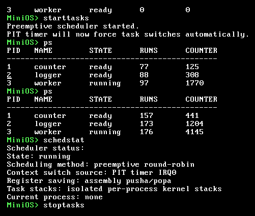
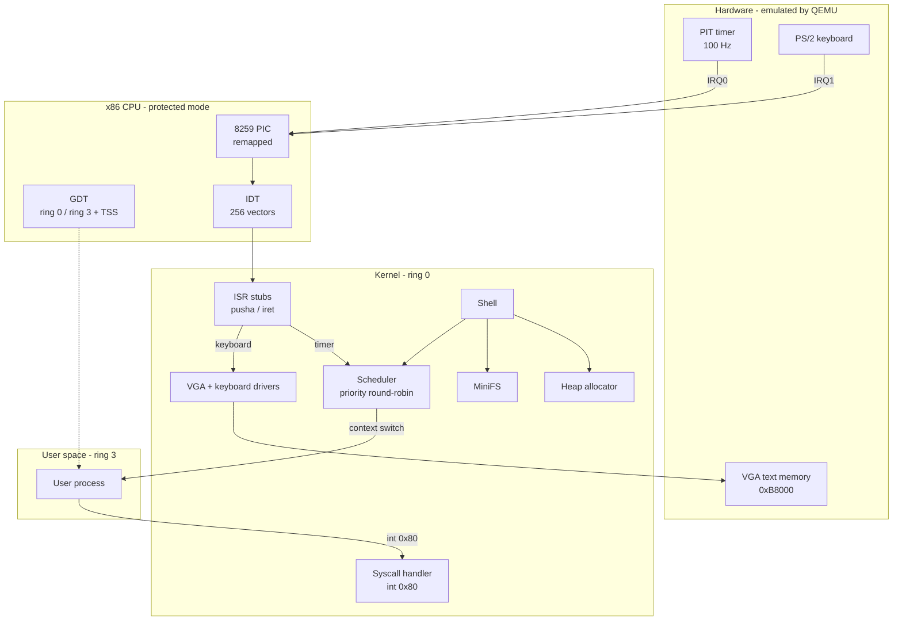
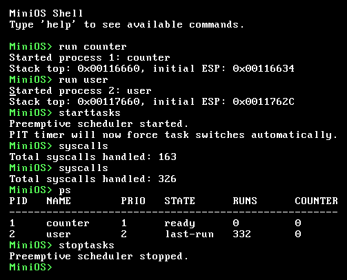
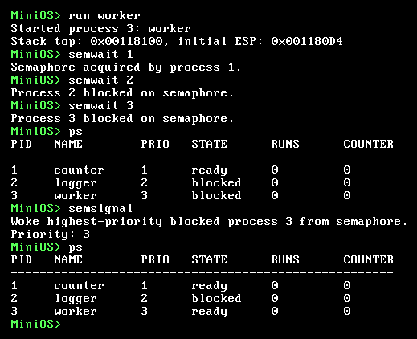
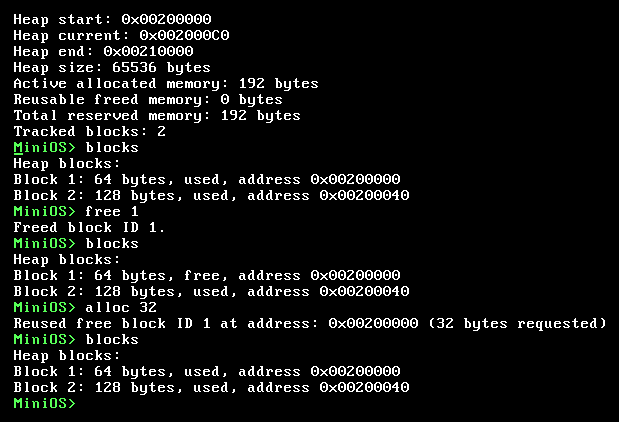
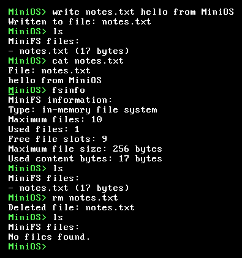
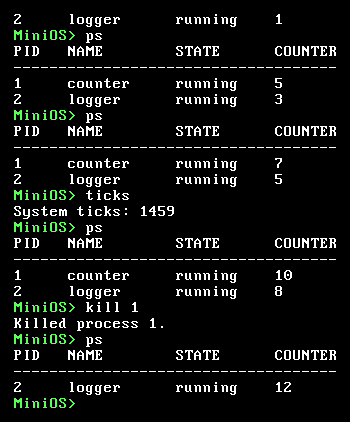
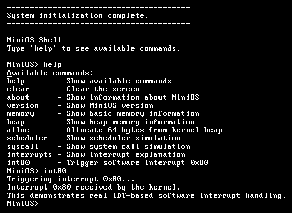
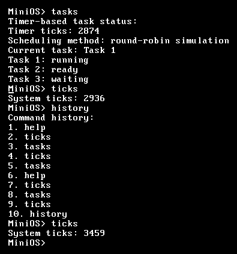

<div align="center">

# MiniOS: x86 Bare-Metal Kernel

**A 32-bit protected-mode operating system kernel written from scratch in C and x86 Assembly. It has preemptive multitasking, ring 3 user mode, interrupts, a heap allocator and a file system.**


<br>



<sub>Three processes being preempted by the hardware timer. The run counters climb on every <code>ps</code>.</sub>

</div>

---

## Overview

MiniOS boots on bare x86 hardware (emulated by QEMU), with no operating system, standard library or runtime underneath it. It programs the CPU and legacy PC hardware directly: segment descriptors, interrupt tables, the 8259 PIC, the 8253/8254 PIT timer, the PS/2 keyboard controller and VGA text memory.

It was built one feature at a time, from printing to the screen up to **preemptive context switching** and **ring 0 / ring 3 privilege separation**. The [commit history](../../commits/main) shows each step.

## Features

| Area | What's implemented |
|------|--------------------|
| **Boot** | Multiboot-compliant entry point in NASM. The kernel loads at 1 MB with a 16 KB boot stack |
| **CPU setup** | GDT with ring 0 and ring 3 code and data segments, plus a **TSS** for privilege-level stack switching |
| **Interrupts** | 256-entry **IDT**, **8259 PIC** remapped to vectors 0x20–0x2F, and assembly ISR stubs that save and restore registers |
| **Timer** | **8253/8254 PIT** programmed to 100 Hz on IRQ0, driving the system tick and the scheduler |
| **Keyboard** | Interrupt-driven **PS/2** driver on IRQ1, with a scancode ring buffer, Shift handling and extended keys (arrows, PgUp and PgDn) |
| **Display** | Direct **VGA text mode** at `0xB8000` with colors and a 200-line scrollback buffer |
| **Multitasking** | **Preemptive, priority-based round-robin scheduler**: the timer interrupt swaps stack pointers to switch tasks, and each process has its own 4 KB kernel stack |
| **User mode** | Processes can start in **ring 3** through a hand-built `iret` frame. They call the kernel through an `int 0x80` **system call** gate, and the kernel checks the caller's privilege level |
| **Synchronization** | Semaphore with blocking and wakeup that wakes the **highest-priority** waiting process first |
| **Memory** | 64 KB kernel heap with `kmalloc`, block tracking, `free` and **first-fit reuse** of freed blocks |
| **File system** | **MiniFS**, an in-memory file system with create, write, read, delete and list |
| **Shell** | Interactive shell with about 40 commands, **command history** on the arrow keys and a RAM text editor |

## Architecture



### Memory map

| Address | Region |
|---------|--------|
| `0x000B8000` | VGA text-mode framebuffer (80×25) |
| `0x00100000` | Kernel image (`.multiboot`, `.text`, `.rodata`, `.data`, `.bss`) |
| `0x00200000 – 0x00210000` | Kernel heap (64 KB) |

## How the key parts work

### Preemptive context switching

On every timer tick (IRQ0), the assembly stub runs `pusha` and passes the current `ESP` to `timer_interrupt_handler()` in C. The scheduler saves that `ESP` into the current process's entry and picks the next ready process with the highest priority, rotating between processes of equal priority. It then returns the **new** process's saved `ESP`. The stub loads that stack, runs `popa` and `iret`, and the CPU continues in a different task.

New processes start on a hand-built stack frame that looks exactly like an interrupted task, so the first `iret` jumps straight into their entry point. After each round, the scheduler hands control back to the kernel context, which keeps the shell responsive while tasks run.

### Ring 3 user mode and system calls

The GDT defines user code and data segments with privilege level 3 (selectors `0x1B` and `0x23`), and a **TSS** gives the CPU a kernel stack to switch to when an interrupt arrives from user mode. A user process is started with an `iret` frame that contains the user `SS:ESP`, `EFLAGS` with interrupts enabled, and the user `CS:EIP`. That drops the CPU into ring 3.

The user task calls the kernel with `int 0x80`. That IDT gate has privilege level 3, so user code is allowed to call it. The handler reads the saved `CS` and checks its low two bits to **confirm the call came from ring 3**.

<p align="center">
  
</p>

### Priority semaphores

`semwait` blocks a process when the semaphore is taken. `semsignal` searches the blocked processes and wakes the one with the **highest priority**, not the one that waited longest.

<p align="center">
  
</p>

### Heap allocator

`kmalloc` first looks for a freed block that is big enough (**first fit**). If there isn't one, it reserves new memory from the top of the heap. Every block is tracked by ID, address, size and whether it's in use, so `free` and the `blocks` command can show exactly how memory is laid out.

<p align="center">
  
</p>

## Screenshots

<table>
  <tr>
    <td align="center"><br><sub><b>MiniFS:</b> create, read and delete files</sub></td>
    <td align="center"><br><sub><b>Processes:</b> live process table and <code>kill</code></sub></td>
  </tr>
  <tr>
    <td align="center"><br><sub><b>Interrupts:</b> IDT-dispatched <code>int 0x80</code></sub></td>
    <td align="center"><br><sub><b>Shell:</b> command history and timer ticks</sub></td>
  </tr>
</table>

## Getting started

### Prerequisites

You need a Linux environment (native, a VM or WSL) with a 32-bit capable GCC, NASM, GNU ld and QEMU.

```sh
# Debian / Ubuntu
sudo apt install build-essential gcc-multilib nasm qemu-system-x86
```

### Build and run

```sh
git clone https://github.com/Amr-Khaled-Amein/x86-Bare-Metal-Kernel.git
cd x86-Bare-Metal-Kernel
make run        # builds build/kernel.bin and boots it in QEMU
```

| Target | Description |
|--------|-------------|
| `make` | Build `build/kernel.bin` |
| `make run` | Build and boot in QEMU (`qemu-system-i386 -kernel`) |
| `make clean` | Remove build output |

### Try it

```text
MiniOS> run counter          # start a priority-1 kernel task
MiniOS> run worker           # start a priority-3 kernel task
MiniOS> run user             # start a ring 3 user-mode task
MiniOS> starttasks           # enable the preemptive scheduler
MiniOS> ps                   # watch RUNS and COUNTER grow
MiniOS> syscalls             # count int 0x80 calls from user mode
MiniOS> stoptasks
```

<details>
<summary><b>All shell commands</b></summary>

| Category | Commands |
|----------|----------|
| General | `help`, `clear`, `about`, `version`, `history` |
| Memory | `memory`, `heap`, `alloc [N]`, `free [ID]`, `blocks` |
| Processes | `ps`, `run counter\|logger\|worker\|user`, `kill PID` |
| Scheduler | `starttasks`, `stoptasks`, `schedstat`, `tasks`, `ticks` |
| Synchronization | `semwait PID`, `semsignal`, `semstat` |
| Interrupts and syscalls | `int80`, `syscalls`, `interrupts-demo`, `syscall-demo`, `scheduler-demo` |
| File system | `ls`, `touch NAME`, `write NAME TEXT`, `cat NAME`, `rm NAME`, `fsinfo` |
| Text editor | `edit`, `show`, `clearbuf`, `bufinfo` |

**Keys:** ↑ / ↓ move through command history, and PgUp / PgDn scroll the terminal.

</details>

## Project structure

```
.
├── boot/
│   └── boot.asm              # Multiboot header and kernel entry point
├── kernel/
│   ├── kernel.c              # kernel_main: initializes every subsystem
│   ├── gdt.c, gdt_flush.asm  # GDT, TSS, ring 0/3 segments
│   ├── idt.c                 # IDT, PIC remap, PIT setup, syscall handler
│   ├── interrupt_stubs.asm   # ISR/IRQ entry stubs (pusha / iret)
│   ├── process.c             # Process table, scheduler, semaphores
│   ├── user_task.asm         # Ring 3 user task
│   ├── heap.c                # Kernel heap allocator
│   ├── minifs.c              # In-memory file system
│   ├── keyboard.c            # PS/2 keyboard driver
│   ├── vga.c                 # VGA text-mode driver and scrollback
│   ├── shell.c               # Command shell
│   ├── history.c             # Command history
│   ├── text_buffer.c         # RAM text editor
│   └── ports.c               # inb / outb port I/O
├── docs/images/              # Screenshots
├── linker.ld                 # Places the kernel at 1 MB
└── Makefile
```

## Roadmap

- [ ] Paging and virtual memory with per-process address spaces
- [ ] CPU exception handlers (page fault, general protection fault) with register dumps
- [ ] A proper syscall table (`write`, `exit`, `sleep`, ...) for user programs
- [ ] Load user programs from MiniFS instead of compiling them into the kernel
- [ ] A bootable ISO with GRUB

## License

Released under the [MIT License](LICENSE).

<div align="center"><sub>Built by <b>Amr Khaled Amein</b></sub></div>
